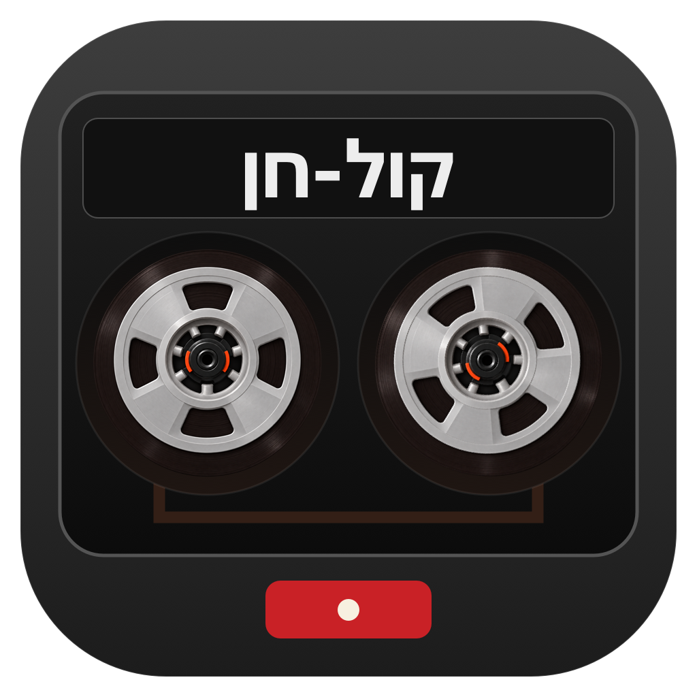
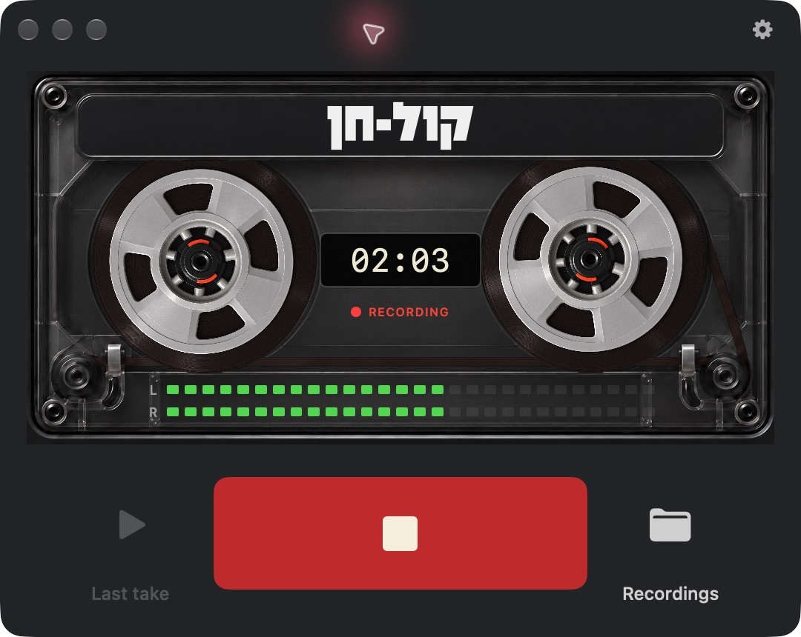
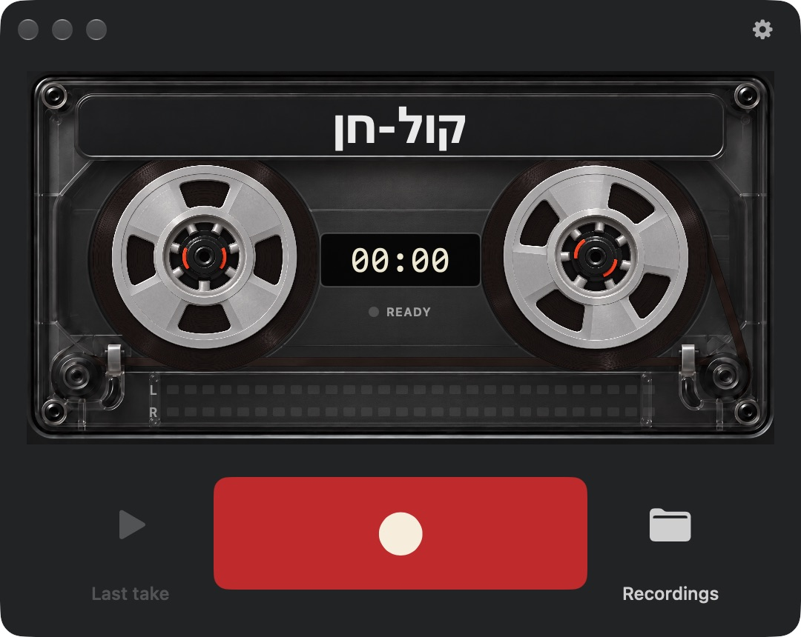
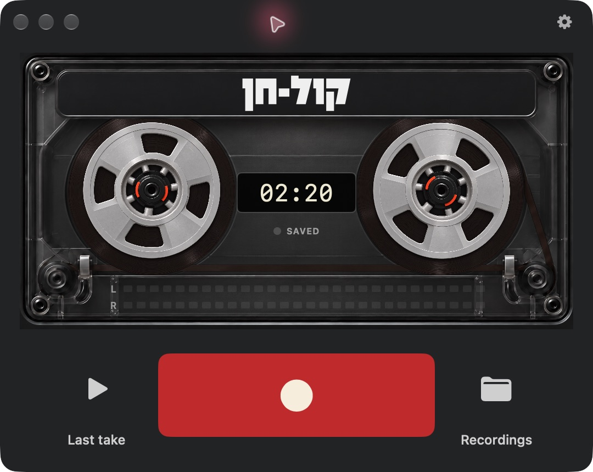
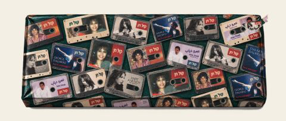
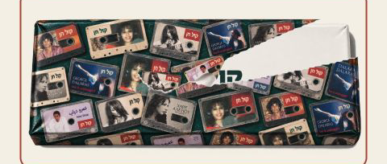
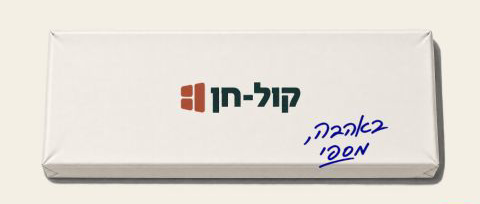
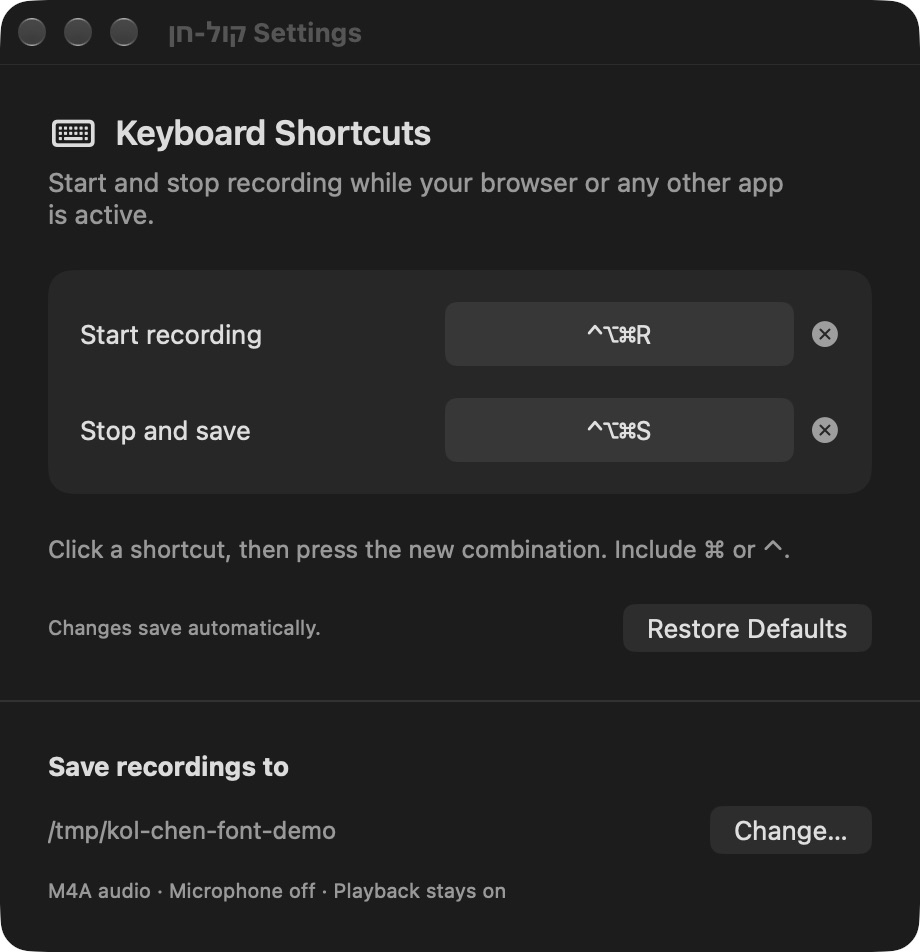

<div dir="rtl">

<p align="center">
  
</p>

<h1 align="center">קול-חן</h1>
<p align="center"><strong>להקליט את מה שמתנגן. להמשיך להקשיב.</strong></p>
<p align="center">אפליקציית מק קטנה, עם קסטה כהה וקצת געגוע.</p>

[English](README.en.md) · [קוד המקור](Sources) · [תיעוד המדיה](docs/media/README.md)

יש אתר שמנגן משהו שרוצים לשמור. קול-חן מקליטה את השמע שיוצא מהמחשב, בזמן שממשיכים לשמוע אותו ברמקולים או באוזניות הרגילים. לוחצים על האדום, מקשיבים, עוצרים. ההקלטה נשמרת במחשב.

<p align="center">
  
</p>

> הפונט בצילומים ובסרטון הוא פופר מהגרסה שמותקנת אצלי, באישור נקודתי מבן נתן להדגמה בבלוג שלי ובמדיית ההדגמה בריפו הציבורי הזה. הפונט אינו מצורף לריפו; הגרסה הציבורית משתמשת בכתב מערכת.

## הקסטה בפעולה

זה צילום מסך בווידאו של אפליקציית המק עצמה: הגלגלים מסתובבים בזמן הקלטה, מדדי הסטריאו מגיבים לשמע, והכפתור האדום הופך לכפתור עצירה. הסרטון שקט.

https://github.com/user-attachments/assets/ce37880f-35e6-45d2-be02-e71dcef6f7ad

[קובץ הווידאו](docs/media/app-demo.mp4) · [תצוגת GIF](docs/media/app-demo.gif)

| מוכנה | מקליטה | נשמרה |
| --- | --- | --- |
|  |  |  |

## מה יש בפנים

- הקלטת שמע מאתרים ומאפליקציות לקובץ סטריאו מסוג AAC, בסיומת `.m4a`.
- המשך האזנה בפלט השמע הרגיל, בלי להתקין התקן שמע וירטואלי.
- קיצורי מקלדת נפרדים להתחלה ולעצירה, גם כשעובדים באפליקציה אחרת.
- מדדי שמע אמיתיים וגלגלי קסטה שמסתובבים בזמן הקלטה. האנימציה מכבדת את הגדרת Reduce Motion של המק.
- בחירת תיקיית שמירה, האזנה להקלטה האחרונה ופתיחת ההקלטות ב־Finder.
- שליטה משורת התפריטים והמשך הקלטה כשהחלון סגור.

ההקלטה תופסת את כלל השמע שמתנגן במחשב, כולל צלילים מאפליקציות אחרות. נגנים עם הגנת תוכן עשויים למנוע הקלטה.

## לפתוח מתנה

גם ההגעה לאפליקציה יכולה להיות רגע קטן ונעים: עטיפת נייר, קריעה, קופסה והקדשה בכתב יד.

https://github.com/user-attachments/assets/f7499958-7894-4a36-928b-a376c98be255

**זהו קונספט עיצובי לפתיחת מתנה.** הקטע מגיע מניסוי קודם למתקין Windows ומציג את פתיחת העטיפה בלבד. הוא עדיין אינו מחובר למתקין מק. דרך ההתקנה הזמינה כרגע מתועדת בהמשך.

| עטופה | נפתחת | בפנים |
| --- | --- | --- |
|  |  |  |

[וידאו פתיחת המתנה](docs/media/gift-opening-preview.mp4) · [תצוגת GIF](docs/media/gift-opening-preview.gif)

## בנייה ופתיחה במק

נדרשים מק עם Apple Silicon, מערכת macOS 15 ומעלה ו־Xcode עם Swift 6.

<div dir="ltr">

```sh
git clone https://github.com/seffyfisher/kol-chen.git
cd kol-chen
zsh build.sh
open build/kol-chen.app
```

</div>

הסקריפט יוצר אפליקציה חתומה מקומית בתיקיית `build`. אפשר להעתיק אותה לתיקיית Applications. זו גרסת בנייה מהמקור, ללא חבילת DMG מאומתת ב־notarization או מתקין המתנה שמוצג למעלה.

1. פותחים את קול-חן ולוחצים על כפתור ההקלטה האדום.
2. מאשרים הקלטת שמע מערכת כש־macOS מבקשת.
3. מנגנים את השמע באתר או באפליקציה הרצויים.
4. לוחצים על הריבוע האדום לעצירה ולשמירה.

אם חסרה הרשאה, פותחים **System Settings → Privacy & Security → Screen & System Audio Recording**, מאשרים את **קול-חן** ופותחים אותה מחדש.

ברירת המחדל לשמירה היא `~/Music/kol-chen`. כפתור גלגל השיניים פותח את בחירת התיקייה והקיצורים.

## הקיצורים שלכם

| פעולה | ברירת מחדל |
| --- | --- |
| התחלת הקלטה | Control–Option–Command–R |
| עצירה ושמירה | Control–Option–Command–S |

אפשר להחליף כל צירוף בהגדרות. הקיצורים נשמרים בין הפעלות, ופועלים גם כשהאפליקציה ברקע. אין צורך בהרשאת Accessibility או Input Monitoring.

<p align="center">
  
</p>

## פרטיות

ההקלטה והעיבוד נעשים מקומית. האפליקציה אינה מקליטה את המיקרופון, אינה מעלה את ההקלטות לשרת ואינה דורשת חשבון.

## למפתחים

האפליקציה כתובה ב־SwiftUI. ההקלטה משתמשת ב־Core Audio process tap, ומשאירה את פלט השמע הרגיל פעיל.

<div dir="ltr">

```sh
zsh test.sh
```

</div>

הבדיקות מכסות קידוד סטריאו ב־44.1/48 kHz, סגירת קבצים תקינה, תנועת הגלגלים, רישום קיצורים ושמירתם. נבדקה גם הקלטה אמיתית מ־Safari ברמקולים המובנים, כולל פענוח הקובץ שנשמר ובדיקת החלפת פלט שמע. אלו בדיקות מקומיות; התקני שמע אחרים ולחיצות פיזיות על הקיצורים דורשים בדיקה במחשב הרלוונטי.

| קובץ | אחריות |
| --- | --- |
| [`KolChenApp.swift`](Sources/KolChenApp.swift) | מצב ההקלטה, מחזור חיי האפליקציה והתפריטים |
| [`AudioRecorder.swift`](Sources/AudioRecorder.swift) | לכידת שמע וקידוד AAC ברקע |
| [`CassetteView.swift`](Sources/CassetteView.swift) | ממשק הקסטה וההגדרות |
| [`RecordingShortcuts.swift`](Sources/RecordingShortcuts.swift) | קיצורי מקלדת גלובליים |
| [`ReelMotion.swift`](Sources/ReelMotion.swift) | תנועת הגלגלים לפי מצב ההקלטה |

למיתוג מקומי משלכם, ראו [הנחיות המיתוג](docs/branding.md). פרטי יצירת הסרטונים והתמונות נמצאים ב[תיעוד המדיה](docs/media/README.md).

</div>
